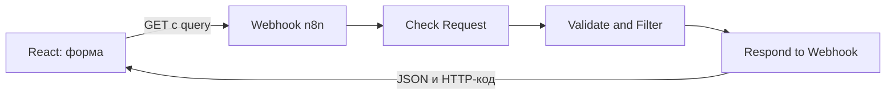

# ДЗ 8 — интерфейс сервиса поверх n8n

## 1. AI-прототип и работающий интерфейс

Приложение проверяет строку по заданным правилам и ищет совпадения в списке Alpha, Beta, Gamma, Delta, Omega. Основной сценарий: ввод → отправка формы → проверка и поиск → видимый результат.

Прототип создан в **v0** на React, TypeScript, Next.js и shadcn/ui. Сохранены [неизменённый ZIP](prototype/v0-export.zip), [исходники](prototype/v0/) и [описание промптов и исправлений](design.md). Прототип имитирует ответ сервера; его демонстрационная панель предназначена только для просмотра состояний.

Рабочий интерфейс перенесён на **React + TypeScript + Vite**. Он сохраняет компоновку прототипа: форма и правила слева, результаты справа, светлая тема, зелёный акцент и карточки. На узком экране блоки располагаются одной колонкой. Демопанели и имитации запросов в рабочем приложении нет.

Рабочая цепочка:



React отправляет строку в настоящий webhook n8n. Check Request проверяет структуру параметра, Validate and Filter выполняет валидацию и фильтрацию, Respond to Webhook возвращает результат с HTTP-кодом. [Контракт API](api-contract.md) фиксирует запросы и ответы.

### Запуск

Команды выполняются из корня репозитория в PowerShell:

```powershell
.\defense.ps1 setup
.\defense.ps1 workflow
.\defense.ps1 dev
```

`setup` проверяет Node.js и pnpm. При их отсутствии на Windows устанавливает portable Node.js 24.22.3 и pnpm 11.25.0 в `%LOCALAPPDATA%\HomeworkTools`, без прав администратора и постоянных изменений PATH. Архив Node.js проверяется по официальному SHA-256. Затем устанавливаются зависимости и создаётся `.env.local` из примера, только если файла ещё нет. Все действия defense.ps1 автоматически используют локальные инструменты. `workflow` проверяет экспортированную логику нод локально. `dev` запускает рабочий экран на http://127.0.0.1:5173. Если этот проект уже работает на порту 5173, команда проверяет процесс и ответ страницы, затем возвращает адрес без запуска второго экземпляра. Посторонние процессы не останавливаются.

Прототип запускается в другом терминале:

```powershell
.\defense.ps1 prototype
```

Адрес прототипа выводится Next.js, обычно http://127.0.0.1:3000. Если соответствующий сервер уже работает, повторный запуск не нужен. Реальная интеграция требует сети и опубликованного workflow n8n. Адрес задаётся через `VITE_ITEMS_WEBHOOK_URL`, ключи не используются.

## 2. Библиотека компонентов и единое оформление

Выбранная библиотека — **shadcn/ui на Base UI**. Используются готовые Button, Input, Card, Badge, Alert и Label. Их исходники находятся в [frontend/src/components/ui](frontend/src/components/ui/).

Общие цвета, радиусы и шрифты заданы в [styles.css](frontend/src/styles.css). Отступы, размеры и адаптивная сетка задаются общими классами Tailwind. Поля и кнопки имеют единое оформление и видимый индикатор фокуса. В рабочей версии применён системный стек шрифтов вместо механизма Next.js.

Поле имеет label и связанные подсказки через aria-describedby. Ошибка обозначается aria-invalid и role=alert. Результаты объявляются через aria-live/role=status, ожидание — через aria-busy. Отправка поддерживает Enter, навигация — Tab. Сброс возвращает фокус в поле.

## 3. Основной пользовательский сценарий

Запрос отправляется кнопкой «Проверить и найти» или Enter. Поиск выполняется по подстроке без учёта регистра.

| Ввод / действие | Результат |
|---|---|
| `alp` → Enter | Alpha, состояние «Успех» |
| `GA` → отправка | Gamma и Omega |
| Пустая строка → отправка | Все пять элементов |
| Изменение строки после поиска | Подсказка, что новый запрос ещё не применён; старый результат подписан своим запросом |
| «Сбросить» | Пустое поле, исходный список и фокус в поле |

Каждый отправленный поиск получает результат от n8n. Исходный экран и сброс используют фиксированный набор из предыдущей версии проекта. Ответ успеха имеет вид `{"items":[{"id":"1","name":"Alpha"}]}`.

В DevTools → Network виден фактический GET-запрос с параметром query и JSON-ответом. В n8n → Executions отображается соответствующий запуск workflow. [Скриншот ноды](evidence/02-n8n-response-alpha.png) подтверждает данные и настройки ответа, но не содержит номера/времени Execution.

## 4. Валидация формы

Допустимы латинские буквы, цифры и пробельные символы JavaScript `\s`. Максимальная длина — 40 кодовых единиц UTF-16. Ввод не обрезается и не очищается через trim. Длина проверяется отдельно от допустимости символов, в том числе для случая «40 букв и завершающий перевод строки».

Пустой запрос допустим по контракту, поэтому поле намеренно не required. `@@@`, кириллица и 41 символ вызывают ошибку. Текст сохраняется, ошибка видна у поля, фокус возвращается в поле. При редактировании предыдущая ошибка снимается.

Клиентская проверка не отправляет очевидно неверный ввод. Сервер независимо проверяет запрос и возвращает HTTP 400 с кодом INVALID_FILTER. Некорректная структура запроса даёт INVALID_REQUEST. Ошибка валидации не превращается в пустой результат: предыдущий список сохраняется.

## 5. Защита от повторной отправки

В [StringValidator](frontend/src/components/validator/string-validator.tsx) ссылка на активный AbortController устанавливается синхронно до await. Повторный submit при активном запросе сразу завершается без нового fetch. Эта защита действует даже до перерисовки React. Дополнительно на время загрузки блокируется кнопка отправки и проверяется состояние в обработчике формы.

Сброс отменяет запрос. Перед обновлением интерфейса проверяются отмена и актуальность контроллера, поэтому устаревший ответ не должен заменить новый результат.

Воспроизводимая ручная проверка: DevTools → Network → Slow 3G, очистка списка запросов, отправка GA и повторный Enter во время ожидания. В Network должен оставаться один запрос поиска. Автотесты отдельно проверяют двойной клик, повторный Enter и два синхронных submit.

Мобильный браузерный тест выявил смещение кнопок при исчезновении подсказки после отправки: второй клик мог попасть в сброс. В рабочей версии зарезервирована высота области статуса. После исправления тест проходит на desktop и mobile.

## 6. Загрузка, пустые данные, успех и ошибка

| Состояние | Поведение и воспроизведение |
|---|---|
| Успех | alp → Alpha; GA → Gamma и Omega; результат подписан применённым запросом |
| Загрузка | При ожидании видны «Проверяем…», индикатор и прежний список; для наблюдения используется Network → Slow 3G |
| Пустые данные | zzz → HTTP 200 с items: [], состояние «Ничего не найдено» |
| Ошибка валидации | @@@ → сообщение у поля, сохранение ввода и прежних результатов |
| Ошибка запроса | Network → Offline, затем отправка допустимого запроса → сообщение о недоступности, сохранённый ввод и «Повторить» |
| Восстановление | Возврат No throttling и нажатие «Повторить» → настоящий запрос и успешный результат; отправляется текущее поле |

Настройки Network меняют условия соединения в браузере, а не логику рабочего API. После ручной проверки возвращается No throttling. HTTP 500, неожиданный JSON и сетевой сбой обрабатываются как ошибка запроса; таймаут — 15 секунд.

Для узкого экрана используется Device Toolbar шириной около 390 px: содержимое располагается одной колонкой без горизонтальной прокрутки. Автотесты используют мобильную эмуляцию в Chromium, не настоящий iOS Safari.

## 7. Клиентские тесты, созданные с помощью AI

Тесты подготовлены с помощью Codex, затем проверены реальными запусками и исправлены. Используются Vitest, Testing Library, MSW и Playwright Test.

```powershell
.\defense.ps1 test
```

Команда последовательно выполняет `pnpm test` и `pnpm test:e2e`. Сохранённый успешный результат: **25 Vitest и 4 Playwright**. [Лог полного запуска](test-evidence/client-tests.log).

| Группа | Проверяемое поведение |
|---|---|
| Компоненты | Подписанная форма, кнопки, правила, счётчик и исходный список |
| Взаимодействия | Выбор примера, ввод, Enter, отправка кнопкой, сброс и возврат фокуса |
| Валидация | Спецсимволы, кириллица, 41 символ, граница 40, пустая строка, ошибка HTTP 400 |
| Состояния | Загрузка и прежний список, успех, пустой ответ, HTTP 500, сеть и успешный повтор |
| Повторная отправка | Один запрос при двойном клике, повторном Enter и двух submit до перерисовки |
| Отмена | Сброс и защита от запоздавшего ответа |
| Контракт ответа | Неправильная обёртка, неверные типы, дубли id и не-JSON ответ |
| Полный сценарий | В браузере: ввод → отправка → видимый результат → пустой ответ → валидация → сброс; отдельно ошибка и повтор |

Vitest проверяет поведение через DOM в jsdom. Playwright Test выполняет два сценария на двух конфигурациях экрана, всего четыре проверки. Он автоматически поднимает отдельный сервер на 5174 и завершает его после запуска. По умолчанию используется Google Chrome. Вариант с загружаемым Chromium описан в [testing.md](testing.md).

Диалогов в приложении нет, поэтому их открытие/закрытие не тестируется. Пустая строка валидна, поэтому искусственное требование обязательного поля не вводилось.

## 8. Подмена ответов сервера

Изолированные тесты используют endpoint `https://validator.test/items` и не обращаются к опубликованному n8n. Настоящий клиентский fetch сохраняется, перехватывается HTTP-граница.

В [interface.test.tsx](frontend/tests/interface.test.tsx) и [server.ts](frontend/tests/server.ts) используются MSW setupServer, http.get и HttpResponse.json. [Фикстуры](frontend/tests/fixtures.ts) соответствуют формату реального API:

```ts
// Успех
HttpResponse.json({ items: [{ id: '1', name: 'Alpha' }] })

// Пустой ответ
HttpResponse.json({ items: [] })

// Ошибка HTTP
HttpResponse.json(
  { error: { code: 'SERVICE_UNAVAILABLE', message: 'Сервис недоступен.' } },
  { status: 500 },
)
```

Задержка управляется Promise, который освобождается после проверки загрузки и числа запросов. Сетевой сбой моделируется HttpResponse.error(). Незарегистрированные запросы в MSW запрещены через onUnhandledFrame: 'error'.

Ожидаемый результат не вычисляется проверяемым локальным фильтром. В одном тесте сервер возвращает Remote match, отсутствующий в исходном списке; интерфейс должен показать именно полученный ответ.

В [браузерных тестах](frontend/e2e/scenario.spec.ts) используются page.route и route.fulfill: подмена выполняется до обращения к серверу. Успех, пустые данные, задержка и ошибка воспроизводимы без доступности n8n.

Живая интеграция проверяется отдельно при работающем приложении на 5173:

```powershell
.\defense.ps1 live
```

Этот запуск отправляет настоящие запросы. Playwright MCP не использовался; браузерные проверки выполняются через Playwright и Playwright Test.

## 9. Проверка качества тестов намеренной поломкой

```powershell
.\defense.ps1 quality
```

[Скрипт](frontend/verify-test-quality.mjs) сохраняет исходные байты SearchForm, временно скрывает сообщение валидации и запускает три проверки неверного ввода. Они падают, поскольку пользователь больше не видит alert. Далее в finally восстанавливается исходный файл, проверяется SHA-256 и те же тесты запускаются повторно.

Подтверждённый результат:

- [При поломке](test-evidence/mutation-broken.log): 3 failed, код завершения 1.
- [После восстановления](test-evidence/mutation-restored.log): 3 passed, код завершения 0.
- [JSON-результат](test-evidence/mutation-result.json): хеш до и после восстановления совпадает.

Остальные тесты в этом эксперименте отфильтрованы целенаправленно. Верхнеуровневая команда quality завершается успешно, если обнаружила ожидаемое падение и подтвердила восстановление. Она выполняется отдельно от остальных тестов и редактирования SearchForm; во время эксперимента сообщение временно скрывается и в dev-сервере.

Проверка типов и production-сборка:

```powershell
.\defense.ps1 build
```

## 10. Вклад AI и исправления

v0 создал прототип, React-компоненты, тему и демонстрационные состояния. Codex подготовил спецификацию, проверил два экспорта, перенёс интерфейс на Vite, создал workflow n8n, подключил HTTP-клиент и разработал тесты. Пользователь выбрал v0, передал обновлённые экспорты, проверил запуск и опубликовал webhook. Предложенные промпты и история исправлений сохранены в [design.md](design.md); точная переписка внутри v0 не предоставлена.

После проверки исправлены:

- Неоднозначность старого результата при новом вводе: отдельно хранятся текущий, отправленный и применённый запросы.
- Сохранение старой ошибки после редактирования: сообщение снимается при изменении поля.
- Граница длины: отдельная проверка вместо зависимости только от regex с конечным $.
- Исчезновение прежних результатов при ожидании/ошибке: список сохраняется с подписью запроса.
- Повтор предыдущего запроса: кнопка отправляет текущее поле.
- Неполный пример GA → Gamma: корректный результат включает также Omega.
- Смещение кнопок на мобильном экране при двойном клике: сохранена высота области статуса.

В тестовом окружении исправлены параметры Testing Library, настройка MSW 3 и совместимость TypeScript. Ожидания тестов не ослаблялись для сокрытия ошибки приложения. Исходный ZIP v0 сохранён без изменений; рабочая реализация содержит описанные доработки.

## Материалы защиты

- [Отчёт](../../hw8.md) и [PR №8](https://github.com/DaniilEF/Homework_7-8_AI/pull/8).
- [JSON n8n](<workflows/HW 8 — String Validator API.json>), [ZIP v0](prototype/v0-export.zip).
- [Код](frontend/), [контракт API](api-contract.md), [описание тестов](testing.md).
- [Скриншоты](evidence/) и [результаты проверок](test-evidence/README.md).
- [PowerShell-команды](../../defense.ps1) и [Makefile](../../Makefile).

Сохранённые скриншоты подтверждают успех, валидацию, пустые данные, загрузку и данные Respond to Webhook. Отдельных снимков сетевого сбоя/повтора и мобильного экрана нет; эти состояния проверены автоматикой и доступны для живого воспроизведения.
