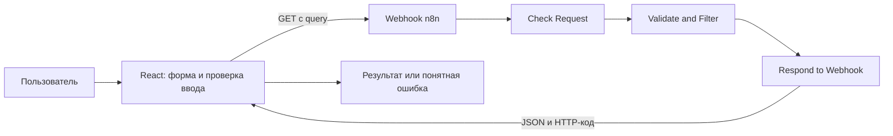

# ДЗ 8 — интерфейс валидатора строк поверх n8n

Проект: [Homework_7-8_AI](https://github.com/DaniilEF/Homework_7-8_AI). Ветка подготовки — `homework-8`. Проверки, описанные ниже, выполнены 18 ноября 2026 года. Работающий интерфейс подключён к n8n; клиентские тесты и сборка прошли. Предоставленные скриншоты успеха, валидации, загрузки, пустых данных и ответа ноды n8n сохранены; отдельного снимка сетевой ошибки пока нет.

## Материалы

- [Спецификация сценария](homework/8/spec.md).
- [Неизменённый экспорт прототипа v0](homework/8/prototype/v0-export.zip), [его исходники](homework/8/prototype/v0/) и [инструкция просмотра](homework/8/prototype/README.md).
- [Промпты, вклад AI и исправления прототипа](homework/8/design.md).
- [Рабочий фронтенд и команды запуска](homework/8/frontend/README.md).
- [Экспорт workflow n8n](<homework/8/workflows/HW 8 — String Validator API.json>) и [контракт API](homework/8/api-contract.md).
- [Клиентские тесты и соответствие проверок сценарию](homework/8/testing.md).
- [Результаты запусков](homework/8/test-evidence/README.md).

Публичная ссылка на проект v0 не предоставлена: для ревью сохранён экспорт. Единственный сохранённый [скриншот прототипа](homework/8/prototype/screenshots/v0-first-review.png) относится к первой версии до исправлений, а не к окончательному интерфейсу. Его нельзя использовать как подтверждение всех состояний обновлённой версии.

## 1. Пользовательский сценарий

Пользователь вводит строку, проверяет её по правилам и получает совпадения в списке Alpha, Beta, Gamma, Delta, Omega. Нажатие «Проверить и найти» или Enter запускает проверку и запрос; справа отображаются результаты с указанием применённого запроса. «Сбросить» очищает поле, возвращает исходный список и фокус в поле.

Поиск идёт по подстроке без учёта регистра. Допустимы латинские буквы, цифры и пробельные символы JavaScript `\s`; длина — до 40 кодовых единиц UTF-16. Строка не обрезается и не очищается через trim. Пустая строка допустима, поэтому поле не required. На сервере длина проверяется отдельно от допустимости символов.

| Ввод | Ожидаемый результат |
|---|---|
| `alp` | Alpha |
| `GA` | Gamma и Omega |
| Пустая строка | Все пять элементов |
| `zzz` | Пустой результат, без ошибки |
| `@@@`, кириллица, 41 символ | Ошибка валидации, ввод сохранён |

Начальный список и сброс используют фиксированный исходный набор предыдущего проекта. Каждый отправленный поиск, включая пустую строку, получает результат из n8n. Клиентская валидация предотвращает очевидно неверный запрос; сервер независимо проверяет входные данные.

## 2. Архитектура и реальная интеграция



Production endpoint: [webhook валидатора](https://n8n-itmo.cyrweb.ru/webhook/hw8-string-validator-items?query=alp). Workflow должен быть опубликован. Адрес задаётся через `VITE_ITEMS_WEBHOOK_URL` в локальном файле окружения; [пример настройки](homework/8/frontend/.env.example) включён в репозиторий. Клиент не передаёт cookies или ключи; workflow работает с публичным фиксированным набором данных. В ответе настроен CORS для обращения из локального браузера.

`Check Request` проверяет наличие строкового параметра query. `Validate and Filter` проверяет длину и символы, выполняет поиск и формирует ответ. `Respond to Webhook` возвращает непосредственно JSON-тело и нужный HTTP-код:

```json
{"items":[{"id":"1","name":"Alpha"}]}
```

Пустой результат — HTTP 200 с `{"items":[]}`. Ошибка фильтра — HTTP 400 с `{"error":{"code":"INVALID_FILTER","message":"…"}}`. Отсутствующий/нестроковый query даёт `INVALID_REQUEST`. Внутренние поля n8n `statusCode` и `body` в клиентский ответ не попадают.

Реальные HTTP-ответы проверены для alp, GA, zzz, пустого и неверного запроса. Отдельный [браузерный сценарий живой интеграции](homework/8/frontend/smoke-live.mjs) подтвердил поиск, Enter, пустые данные, валидацию, восстановление после Offline, сброс и мобильную ширину. Это отдельная проверка: изолированные клиентские тесты ниже не обращаются к рабочему n8n.

## 3. Прототип, библиотека и оформление

Прототип создан с помощью v0 на React, TypeScript, Next.js и shadcn/ui. Для рабочего приложения React-компоненты перенесены на Vite. Сохранены форма и правила слева, карточка результата справа, зелёный акцент, скругления, подписи и основные состояния; на узком экране блоки идут одной колонкой.

Библиотека — **shadcn/ui на Base UI**. Используются готовые [Button](homework/8/frontend/src/components/ui/button.tsx), [Input](homework/8/frontend/src/components/ui/input.tsx), [Card](homework/8/frontend/src/components/ui/card.tsx), [Badge](homework/8/frontend/src/components/ui/badge.tsx), [Alert](homework/8/frontend/src/components/ui/alert.tsx) и Label. Общие цвета, радиусы и шрифты заданы в [styles.css](homework/8/frontend/src/styles.css); отступы и адаптивная сетка — общими классами Tailwind.

В рабочем приложении демопанель и имитация запросов удалены. Шрифты заданы системным стеком без зависимости от Next.js. Исправлены примеры GA: подстрока встречается также в Omega. По результатам мобильного теста зарезервирована высота области статуса, чтобы после отправки кнопки не смещались под вторым кликом. Эти изменения документированы; исходный экспорт v0 сохранён без правок.

## 4. Состояния, доступность и повторная отправка

Форма имеет явный label, подсказки и счётчик через aria-describedby, ошибки с role=alert и aria-invalid. Результаты объявляются через role=status/aria-live; во время ожидания выставляется aria-busy. Видимый фокус задан в компонентах. Основной сценарий выполняется с клавиатуры, после ошибки и сброса фокус возвращается в поле.

| Состояние | Поведение |
|---|---|
| Исходное | Пустое поле, полный список |
| Новый ввод | Подсказка, что строка ещё не применена; старый результат подписан своим запросом |
| Загрузка | Индикатор, блокировка отправки, сохранение прежнего списка |
| Успех | Полученные от n8n элементы и применённый запрос |
| Пусто | «Ничего не найдено», предложение изменить запрос или сбросить |
| Ошибка ввода | Пояснение у поля, сохранение текста и прежних результатов; редактирование снимает старую ошибку |
| Ошибка запроса | Сохранение ввода/результатов и кнопка «Повторить», отправляющая текущее значение поля |

Защита реализована в [StringValidator](homework/8/frontend/src/components/validator/string-validator.tsx): ссылка на активный AbortController устанавливается синхронно до await. Поэтому два submit до перерисовки не создают два запроса. Дополнительно кнопка disabled при загрузке. Сброс отменяет запрос; проверка актуальности контроллера не даёт запоздалому ответу перезаписать новый результат. [HTTP-клиент](homework/8/frontend/src/lib/api.ts) обрабатывает сетевой сбой, таймаут 15 секунд, HTTP-ошибки и неверный формат JSON.

## 5. Клиентские тесты и результаты

**Финальный запуск: 25 проверок Vitest и 4 проверки Playwright прошли.** Проверка TypeScript и production-сборка также прошли. Подтверждения: [полный лог тестов](homework/8/test-evidence/client-tests.log) и [лог сборки](homework/8/test-evidence/build.log).

| Проверки | Где реализованы |
|---|---|
| Форма, компоненты, примеры, счётчик, Enter, сброс и фокус | [interface.test.tsx](homework/8/frontend/tests/interface.test.tsx) |
| Неверный ввод, границы длины, пустой запрос, ошибка сервера | Тот же файл; [api.test.ts](homework/8/frontend/tests/api.test.ts) |
| Загрузка, успех, пустой ответ, HTTP 500, сеть и повтор | interface.test.tsx с управляемыми ответами MSW |
| Двойной клик, повтор Enter и два submit до перерисовки | interface.test.tsx, счётчик реальных вызовов HTTP-обработчика |
| Сброс/отмена и защита от устаревшего ответа | interface.test.tsx |
| Полный сценарий на desktop/mobile, повторы и восстановление | [scenario.spec.ts](homework/8/frontend/e2e/scenario.spec.ts) |

**Как подменяются ответы.** Vitest запускает приложение в jsdom через Testing Library. MSW перехватывает настоящий fetch на HTTP-границе; [фикстуры](homework/8/frontend/tests/fixtures.ts) соответствуют формату реального API. Тестовые ответы содержат самостоятельные ожидаемые данные, не вычисляются проверяемым фильтром. В одном тесте сервер возвращает Remote match, отсутствующий в локальном наборе, — UI должен показать именно его.

Playwright Test подменяет ответы через page.route/route.fulfill. Адрес в обоих наборах — validator.test; рабочий webhook не вызывается. Задержка управляется Promise, который освобождает тест после проверки загрузки и количества запросов. Незарегистрированные запросы в MSW запрещены. Мобильный запуск — эмуляция в Chrome/Chromium, не настоящий iOS Safari. Диалогов в сценарии нет, поэтому проверки их открытия не добавлялись.

**Проверка качества тестов.** [Скрипт эксперимента](homework/8/frontend/verify-test-quality.mjs) временно скрывает сообщение ошибки. Три теста неверного ввода падают из-за отсутствующего alert; затем файл восстанавливается, и те же проверки проходят. [JSON-результат](homework/8/test-evidence/mutation-result.json) содержит коды завершения 1 и 0 и одинаковый SHA-256 до/после восстановления. [Падение](homework/8/test-evidence/mutation-broken.log) ожидаемое; [повтор после восстановления](homework/8/test-evidence/mutation-restored.log) успешен. После эксперимента заново выполнен полный клиентский набор.

## 6. Использование AI и исправления

v0 сгенерировал прототип, React-компоненты, тему и демонстрационные состояния. Codex подготовил спецификацию, провёл проверку двух экспортов, перенёс интерфейс на Vite, создал workflow n8n, подключил HTTP-клиент и подготовил тесты. Пользователь выбрал v0, передал обновлённые экспорты, проверил запуск прототипа и опубликовал webhook n8n. Тесты создавались и исправлялись с помощью AI, их качество проверено реальными запусками и намеренной поломкой.

Примеры запросов из переписки:

> «Создай интерактивный прототип приложения “Валидатор строк”. Используй React, TypeScript, shadcn/ui и Tailwind CSS».

> «Сохрани текущий дизайн и исправь поведение»: обозначать изменённый запрос, снимать старую ошибку при редактировании, отдельно проверять длину, сохранять прежние результаты и повторять текущий ввод.

> «вперед пункт 5» — после согласования Vitest + Testing Library, MSW и Playwright Test.

Полные предложенные промпты сохранены в [design.md](homework/8/design.md); точный текст чата v0 не предоставлен и не выдаётся за подтверждённую историю сервиса.

После проверки исправлены: ошибочное ожидание одного совпадения для GA, недостаточная проверка длины в первом экспорте, неоднозначность старого результата при новом вводе, обработка повторной попытки и мобильное смещение кнопок. В тестах исправлены несовместимые параметры Testing Library, настройки MSW 3 и версия TypeScript. Ожидания тестов не ослаблялись для сокрытия ошибки приложения.

Браузерные проверки выполнялись через Playwright и Playwright Test. Playwright MCP не использовался.

## 7. Команды и порядок демонстрации

Из корня репозитория:

```powershell
cd homework/8/frontend
pnpm install --frozen-lockfile
Copy-Item .env.example .env.local
pnpm dev
```

Рабочий экран — http://127.0.0.1:5173. Копировать файл окружения нужно при первой настройке; существующий настроенный .env.local сохраняется. В другом терминале из frontend:

```powershell
pnpm test:all
pnpm test:quality
pnpm build
```

Playwright автоматически поднимает отдельный сервер на 5174. Требуется установленный Chrome; вариант с загружаемым Chromium описан в [testing.md](homework/8/testing.md). Команда test:quality временно меняет исходник, поэтому запускается отдельно от редактирования и других тестов. Секреты в репозиторий не добавляются.

Для отдельной проверки настоящей интеграции при работающем интерфейсе:

```powershell
pnpm test:live
```

Порядок защиты: открыть прототип и рабочий экран → показать библиотеку и тему → пройти поиск и остальные состояния → показать соответствующий Execution n8n → запустить клиентские тесты → открыть HTTP-подмену и проверку числа запросов → показать эксперимент с поломкой и исправления AI.

## Сохранённые скриншоты рабочего интерфейса

| Файл | Что видно |
|---|---|
| [01 — поиск alp](homework/8/evidence/01-search-alp-success.png) | Успех, применённый запрос alp и Alpha |
| [02 — ответ ноды n8n](homework/8/evidence/02-n8n-response-alpha.png) | Respond to Webhook: statusCode 200, body.items с Alpha, настройки тела ответа и HTTP-кода |
| [03 — ошибка валидации](homework/8/evidence/03-validation-error.png) | Ввод @@@ сохранён, сообщение об ошибке, предыдущий результат Alpha |
| [04 — поиск GA](homework/8/evidence/04-search-ga-success.png) | Успешный результат Gamma и Omega, поиск без учёта регистра |
| [05 — пустые данные](homework/8/evidence/05-empty-results.png) | Запрос zzz и состояние «Ничего не найдено» |
| [06 — загрузка](homework/8/evidence/06-loading.png) | Запрос GA выполняется: индикаторы ожидания, кнопка «Проверяем…», сохранённый прежний результат Alpha для alp |

Скриншот ноды n8n показывает её данные и настройки, но не номер/время Execution и не полный HTTP-ответ браузеру. Внутренняя обёртка statusCode/body на панели OUTPUT не означает, что она отправляется клиенту: Response Body настроено как $json.body. Скриншот GA показывает завершённый поиск, а не загрузку. Загрузка дополнительно подтверждена скриншотом 06. В этом наборе нет сетевой ошибки/повтора и мобильного экрана. Автоматические проверки этих состояний описаны отдельно; они не подменяют снимки пользовательской демонстрации.

## Дополнения для живой защиты и публикация

- При необходимости дополнить демонстрацию ошибкой запроса, успешным повтором и мобильным экраном. Загрузка, пустые данные и ошибка валидации уже представлены; отдельные снимки каждого шага не обязательны.
- Подтверждение соответствующего запуска во вкладке Executions n8n; актуальный экспорт из экземпляра n8n, если после импорта настройки менялись.
Готовые команды: [defense.ps1](defense.ps1) и [Makefile](Makefile). [Короткий порядок демонстрации](homework/8/defense.md) связывает команды, сценарии и подтверждения.
Материалы опубликованы в ветке homework-8: [PR №8 в main](https://github.com/DaniilEF/Homework_7-8_AI/pull/8). PR открыт для проверки; слияние не выполнено.
